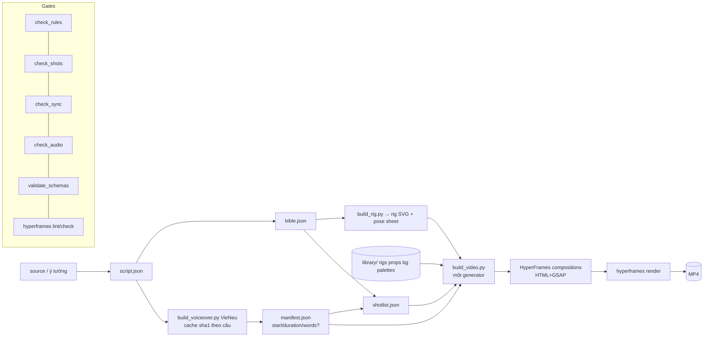
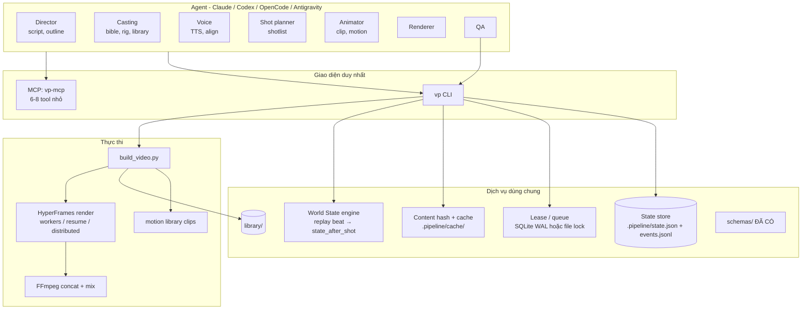
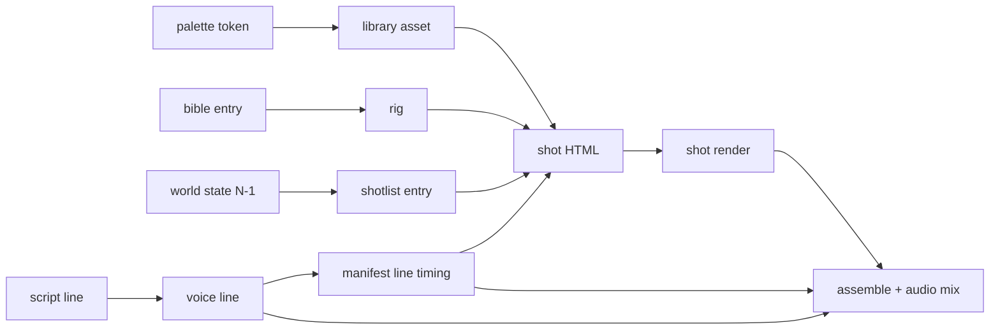

# Research v4 — Audit pipeline, nghiên cứu GitHub, kiến trúc tối ưu

**Ngày:** 2026-11-23. **Trạng thái tài liệu:** nghiên cứu + đề xuất. **Không có thay đổi nào đối với hệ thống production** (không sửa generator, rig, library, project). Mọi mục dưới đây được gắn nhãn:

- **[ĐÃ CÓ]** đã triển khai và đã chạy thử trong repo.
- **[PROTO]** đã có code nhưng mới thử ở mức nhỏ / chưa duyệt.
- **[ĐỀ XUẤT]** chưa làm.
- **[CHƯA KIỂM]** nhận định chưa có bằng chứng chạy thật.

Cách kiểm chứng nghiên cứu GitHub: bốn agent nghiên cứu chạy song song. `gh api` bị chặn trong phiên của họ nên số sao/ngày push/license của đa số repo **không** lấy được từ API. Tôi tự kiểm lại các repo then chốt (HyperFrames, OpenMontage, kinocut, ViMax, Rhubarb) bằng `gh search` và đọc trực tiếp bản clone HyperFrames. Cột "Kiểm chứng" ở §B cho biết mức tin cậy của từng dòng.

---

## A. Current Pipeline Audit

### A1. Sơ đồ hiện tại



### A2. Đánh giá từng giai đoạn

| Giai đoạn | Input → Output | Ai làm / công cụ | Thủ công hoặc lặp lại | Điểm nghẽn / lỗi có thể | Song song? | Người duyệt |
| --- | --- | --- | --- | --- | --- | --- |
| A/B QA nguồn + viết lại | URL → `source/*`, `script.json` | agent + `originality_check.py` | chấm tay 2 danh sách "ý chung / biểu đạt riêng" | máy chỉ đo lời, không đo cốt truyện | nhiều chương song song được | 👤 `diff_matrix` |
| C1 Bible + rig + library | script → `bible.json`, rig SVG, pose sheet | `library.py`, `build_rig.py` | chọn archetype, xem ảnh bằng mắt | pose bảng cứng, chỉ nhìn thẳng, lỗi nhìn (sheet đen) chỉ bắt được bằng xem ảnh | mỗi nhân vật độc lập | 👤 pose sheet (R3.7) |
| C2 Shotlist | script + bible → `shotlist.json` | agent viết tay | **toàn bộ shotlist viết tay**; S01 mới 13 shot cho 46 s | không có kế hoạch trạng thái thế giới; mỗi shot độc lập | theo chương | 👤 duyệt demo |
| C3 Giọng | script → `audio/lines/*.wav`, `manifest.json` | VieNeu trên máy người dùng | cache sha1 theo câu [ĐÃ CÓ] | **không chạy được trong phiên cloud**; `words[]` thật chưa có (đang ước theo ký tự) | theo câu / theo giọng | 👤 nghe thử |
| C4 SFX | shotlist → cue | agent | khai tay từng cue | kho SFX thiếu nhóm cần (gió, dế, lửa) | độc lập | |
| C5 Dựng | manifest + shotlist + rig + library → compositions | `build_video.py` [ĐÃ CÓ] | không | không có cache theo shot: sửa 1 chỗ sinh lại toàn bộ (nhanh, nhưng render thì không) | theo shot (chưa tận dụng) | |
| C6 QC | compositions → pass/fail | 6 gate [ĐÃ CÓ] | xem ảnh snapshot bằng tay (R10.2) | gate chỉ kiểm dữ liệu/khung, không kiểm liên tục hình ảnh | song song được | 👤 |
| D Full | như C trên toàn phim | như trên | **shotlist cho 414 câu / 1.297 s** chưa có; ước ~370 shot ở 3,5 s/shot | số shot ×28 so với demo | theo shot | 👤 |
| E Đóng gói | → xuất bản | `packaging.md` | tay | `check_rules --phase final` | | 👤 |

Số liệu đo trên repo (2026-11-23): ~4.500 dòng Python trong `scripts/`; 3 project; project mẫu 14 MB, 414 câu, 1.296,8 s thoại, shotlist **13 shot** (S01, 46,3 s); library 25 location + 10 prop + 7 archetype + 4 outfit + 3 palette; CI `gates.yml` chỉ chạy kiểm tĩnh (py_compile, `library.py check`, build rig, `check_rules --phase demo`); bộ test `test_roadmap_v3.py` 31 kiểm (chạy lại 2026-11-23: tất cả qua). **[CHƯA KIỂM]** thời gian `hyperframes render` thật, RAM, tỉ lệ cache — chưa từng render mp4 trong repo này, nên không có số đo để so sánh cải tiến (xem §E, đo ở P0).

### A3. Điểm tốt cần giữ

1. Một nguồn thời gian duy nhất `manifest.json`; shot dựng từ manifest (R1.2, R9.4).
2. Một generator đọc dữ liệu, không viết tay HTML từng shot (R1.6).
3. Cache TTS theo câu bằng sha1 payload, có `--force` [ĐÃ CÓ].
4. Library có khoá phiên bản (`LIBRARY.lock.json`), màu chỉ là token, `library.py check`.
5. Gate bằng lệnh máy + luật có ID; E7/E8, `check_audio`, `validate_schemas` mới thêm.
6. HyperFrames deterministic (timeline GSAP paused + seek) — nền tảng đúng cho render có cache.

### A4. Điểm yếu, bottleneck, lãng phí

| # | Vấn đề | Hệ quả | Mức |
| --- | --- | --- | --- |
| 1 | Không có đồ thị phụ thuộc + content hash giữa các công đoạn (chỉ TTS có cache) | Sửa 1 câu/1 asset → phải tự đoán cái gì cần dựng lại; phim 30–60 phút không khả thi | **Cao** |
| 2 | Không có trạng thái thế giới xuyên shot. Mỗi shot khai báo lại nhân vật/đạo cụ; R4.3 chỉ là luật chữ | Cốc đặt xuống ở shot N có thể "biến mất" ở shot N+1 mà gate không bắt | **Cao** |
| 3 | Chuyển động viết riêng từng shot (bảng POSES cứng, beat tạo tween); không có thư viện clip | Mỗi video làm lại động tác; khó mở rộng đi/quay/với tay | Cao |
| 4 | Nhân vật chỉ nhìn thẳng; "đối mặt" chỉ là liếc mắt; `hand_over` là đạo cụ trôi giữa hai tay nghỉ | Tương tác nhân vật thiếu thuyết phục | Cao |
| 5 | Khẩu hình chia đều theo từ; mốc từ là ước tính | Lệch môi; E8 neo beat theo từ nhưng từ chưa thật | TB |
| 6 | Không có trạng thái pipeline dạng máy đọc được; nhật ký gate là Markdown viết tay | Agent mới không biết phase hiện tại; nhảy bước chỉ bị chặn bằng văn bản | **Cao** |
| 7 | Nhiều agent (Claude/Codex/OpenCode/Antigravity) có thể sửa cùng asset/shotlist; không có khoá | Ghi đè nhau, xung đột | TB |
| 8 | CI chưa dựng/render thử fixture; không có visual regression | Lỗi hình chỉ phát hiện khi người xem | TB |
| 9 | Không có chế độ chất lượng (preview/animatic/production) | Mọi lần dựng đều "nặng" như nhau | TB |
| 10 | Chi phí không được ghi (TTS, provider) | Không kiểm soát khi dùng nhiều provider | Thấp hiện tại |

### A5. Dependency và điểm lãng phí chính

`LIBRARY asset / palette → rig → shot` · `bible → rig + shot` · `script line → TTS → manifest → timing của mọi shot sau nó` · `generator code → mọi shot`. Lãng phí lớn nhất: sửa một câu làm lệch `start` của mọi câu sau, nên nếu key của shot chứa `start` tuyệt đối thì **cả phim** bị invalid. → Cache key phải dùng thời gian **tương đối trong shot** (xem §E1).

---

## B. GitHub Research Report

**Phương pháp và giới hạn:** (1) bốn agent nghiên cứu theo nhóm A–F; (2) `gh api` bị chặn trong phiên của họ, họ dùng `gh search`, clone nông, WebFetch; (3) tôi kiểm lại bằng `gh search` + đọc bản clone HyperFrames. Không repo nào bị copy code vào dự án. Mọi license cần đọc lại LICENSE trước khi tích hợp thật.

Cột **KC** = kiểm chứng: **T** = tôi tự kiểm (license/ngày/mã nguồn); **A** = do agent báo từ clone/trang repo; **U** = chưa kiểm.

### B1. Nên tích hợp trực tiếp

| Repository | Công nghệ | Điểm đáng học | Tích hợp | License | KC |
| --- | --- | --- | --- | --- | --- |
| heygen-com/hyperframes | TS, Chromium + FFmpeg | Bộ render đang dùng. Mã nguồn có: `--workers N\|auto`, `--docker` (deterministic), `--frames-cache-dir`, `--resume`, `--start/--end`, `hyperframes diff`, `normalize-audio`; gói `producer/distributed` (`planV2/renderChunkV2/assembleV2`), `aws-lambda`, `gcp-cloud-run` | Trực tiếp; dùng đúng tính năng thay vì tự viết | Apache-2.0 | **T** (LICENSE + `render.ts` flags + thư mục `distributed/`, push 2026-11-23); **chưa chạy** CLI |
| statelyai/xstate | TS | Máy trạng thái, `SimulatedClock`, `machineFromJSON`, sinh đường kiểm thử | Dùng lúc build (offline) để kiểm tính hợp lệ chuyển động nhân vật | MIT | A |
| Breakthrough/PySceneDetect | Python | Phát hiện điểm cắt | Kiểm điểm cắt bản render khớp shotlist | BSD-3-Clause | A |
| slhck/ffmpeg-quality-metrics | Python/FFmpeg | PSNR/SSIM/VMAF ra JSON | So bản render mới với bản vàng | MIT | A |
| mapbox/pixelmatch | JS | Diff điểm ảnh có dung sai khử răng cưa | Visual regression trên PNG snapshot | chưa đọc (ISC theo trí nhớ) | **U** license |
| JohannesBuchner/imagehash | Python | pHash/dHash | Kiểm trôi hình nhanh | BSD (A) | A |

### B2. Nên viết adapter

| Repository | Công nghệ | Điểm đáng học | Lý do adapter | License | KC |
| --- | --- | --- | --- | --- | --- |
| KyaniteLabs/kinocut (trước là mcp-video) | Python, FFmpeg, MCP+CLI | Job spec có `spec_hash`, hash vào/ra từng bước, `resume_cursor`; resume từ chối nếu spec đổi; lỗi trả sẵn lệnh retry; 20 tool mặc định + `search_tools` | Bước hậu kỳ (ghép, phụ đề, loudness) và mẫu giao diện MCP | Apache-2.0 | **T** license + push 2026-11-22 (279 sao); kiến trúc A |
| pydoit/doit | Python | Đồ thị task + md5 file + state DB | Bộ chạy ngoài: một task mỗi shot (hoặc tự viết bản tối giản theo cùng ý) | MIT | A |
| MontrealCorpusTools/Montreal-Forced-Aligner (+ `vietnamese_mfa`) | Python/Kaldi | Căn chỉnh cưỡng bức text biết trước → mốc từ + âm vị | Con đường chính cho `words[]` tiếng Việt, chạy được CPU | Code MIT; **model CC-BY-4.0 nhưng dữ liệu huấn luyện có VIVOS (CC BY-NC-SA)** → hỏi pháp lý trước khi dùng thương mại | A |
| DanielSWolf/rhubarb-lip-sync | C++ | Bộ hình miệng A–H + X, JSON `mouthCues` | Dùng làm **từ vựng miệng chuẩn**; chỉ nhận dạng "phonetic" (kém chính xác, tiếng Việt chưa kiểm) | spdx "other" (cần đọc LICENSE) | **T** (spdx other, push 2026-06-16) |
| resemble-ai/Resemblyzer · speechbrain/speechbrain | PyTorch | Embedding giọng → kiểm "cùng nhân vật cùng giọng" | Cần ngưỡng tự hiệu chỉnh trên giọng VieNeu | Apache-2.0 | A |
| m-bain/whisperX | Python | `align()` ra `word_segments` | Dự phòng; mô hình căn chỉnh tiếng Việt mặc định **CC BY-NC 4.0 (không thương mại)** | BSD-2 (code) | A (đã đọc `alignment.py`) |
| ninja-build/ninja | C++ | Đồ thị build tối giản | Tuỳ chọn; doit dễ hơn | Apache-2.0 | A |

### B3. Chỉ nên học kiến trúc

| Repository | Điểm đáng học | Vì sao không dùng code | License | KC |
| --- | --- | --- | --- | --- |
| OpenMontageInc/OpenMontage (~82,6k sao) | Agent là bộ điều phối; manifest pipeline YAML + skill theo stage; checkpoint JSON có nhật ký quyết định, ảnh chụp chi phí, cổng duyệt do bộ ghi checkpoint ép; 20+ JSON Schema giữa các stage | **AGPL-3.0** → rủi ro copyleft nếu đưa code vào | AGPL-3.0 | **T** (license, sao, push 2026-11-16); chi tiết kiến trúc A, README-only |
| HKUDS/ViMax (~13k sao) | Pipeline Idea2Video/Script2Video/Novel2Video, phiên resume, trạng thái render bền | Nhắm sinh video bằng model, không phải rig SVG | MIT | **T** (license, push 2026-09-30) |
| yaogdu/AgentLedger | Lease + fencing token + heartbeat; sổ cái tác dụng phụ | Dự án rất nhỏ (9 sao) | Apache-2.0 | A |
| DBOS-project/dbos-transact-py | Workflow checkpoint, idempotency key, hàng đợi bền | Phụ thuộc Postgres | MIT (U) | U |
| rive-app/rive-wasm · LottieFiles/dotlottie-web · airbnb/lottie-web | State machine có input, clip tham số hoá (slots), bước thời gian thủ công | Canvas/WebGL, không phải SVG rig; editor đóng | MIT | A |
| DragonBones/DragonBonesJS | Armature/slot/bone timeline, `fadeInTime` | Hệ sinh thái gần như ngừng | MIT | A |
| EsotericSoftware/spine-runtimes | `Animation.apply` là hàm lấy mẫu thuần; `AnimationState` trộn track; `IkConstraint` 2 xương | **Giấy phép Spine tuỳ chỉnh, mỗi người dùng cuối cần Spine Editor trả phí** → không đưa code; học ý tưởng | custom | A (đã đọc license) |
| vibecoderkz/raveanima | Lệnh có kiểu, clip JSON, state machine, contact-sheet cho agent, MCP | 3 commit, rất non | MIT | A (chỉ trang repo) |
| Samlinb/openbone | Rig bằng agent qua MCP, import Spine JSON | Ứng dụng Java desktop, không có license nêu trên trang | không rõ | A (chỉ trang repo) |
| AcademySoftwareFoundation/OpenTimelineIO · inkle/ink | Mô hình timeline (xuất sang NLE); trạng thái truyện có snapshot | Không phải máy trạng thái SVG | Apache-2.0 / MIT | A |
| remotion-dev/remotion | Mẫu plan → render chunk → ghép; HyperFrames đã có tương đương | Xem mục dưới | custom | **T** (agent đọc LICENSE.md) |
| snakemake · iterative/dvc · reg-viz/reg-suit | Rerun trigger; `dvc.lock` md5; baseline + báo cáo diff | Nặng hơn nhu cầu repo đơn | MIT/Apache/MIT | A |

### B4. Không phù hợp

- **Remotion** cho sản xuất thương mại: license tuỳ chỉnh, miễn phí cho cá nhân / công ty ≤ 3 nhân viên / phi lợi nhuận; còn lại cần Company License; trang LICENSE nói sẽ đổi ở bản 5.0. HyperFrames đã thay thế được.
- **aeneas** (AGPL, không có tiếng Việt), **whisper-timestamped** (AGPL), **StoryDiffusion/IP-Adapter** (chỉ áp dụng khi sinh ảnh bằng diffusion; pipeline này là SVG tất định), **motion-canvas** (trùng chức năng), **pixijs/spine** (Spine license, Canvas), **arkdutt/FrameWork** (rỗng, không license).

### B5. Không tìm thấy / không kiểm chứng

- Repo tên **"agentic-animation"**: không tìm thấy dự án nào khớp tên (chỉ ra `greensock/gsap-skills`, `LottieFiles/motion-design-skill` — không phải toolkit nhân vật).
- Không có repo SVG-native có skeleton + IK + GSAP còn bảo trì được tìm thấy (agent tìm ~25 lượt, chưa vét hết).
- Không có repo nào làm "continuity checker" cho pipeline tất định; hướng này phải tự xây (§D).
- **Chưa kiểm** cho nhiều repo: ngày push, số issue (API bị chặn); Vietnamese của Rhubarb/Resemblyzer; chất lượng `vietnamese_mfa` trên giọng VieNeu (giọng tổng hợp ≠ giọng đọc thật).

---

## C. Proposed Architecture

**Nguyên tắc:** schema-first (JSON Schema [ĐÃ CÓ, 4 file]); mọi agent giao tiếp qua file có cấu trúc + một CLI `vp`; thực thi tất định; không phụ thuộc cứng provider hay renderer (HyperFrames là adapter thay được); **không tạo hệ thống thứ hai** — mọi thứ mới bọc quanh script hiện có.

### C1. Kiến trúc tổng thể



### C2. Trách nhiệm agent

| Agent | Đọc | Ghi | Không được |
| --- | --- | --- | --- |
| Director | idea, source | `script.json`, `outline.md` | Sửa bible/shotlist |
| Casting | script | `bible.json`, rig, library `use` | Sửa asset trong project (R2.3) |
| Voice | script đã khoá | `audio/*`, `manifest.json` | Sửa manifest tay (R1.2) |
| Shot planner | script, bible, manifest, `state_after_shot_(N-1)` | `shotlist.json` | Đặt đạo cụ/nhân vật không có trong world state |
| Animator | shotlist, clip library | clip mới (qua `library promote`) | Viết tween riêng cho 1 shot |
| Renderer | compositions, cache | shot MP4, bản ghép | Render lại shot không đổi key |
| QA | mọi thứ | báo cáo, baseline được người duyệt | Hạ ngưỡng gate |

### C3. Hợp đồng dữ liệu (data contracts)

| File | Chủ sở hữu | Trạng thái |
| --- | --- | --- |
| `script/script.json`, `bible.json`, `shotlist.json`, `audio/manifest.json` | theo bảng C2 | **[ĐÃ CÓ]** JSON Schema v1 + `validate_schemas.py`, chạy thật trên project mẫu |
| `.pipeline/state.json` (phase, gate đã qua, hash đầu vào) | `vp` | [ĐỀ XUẤT] |
| `.pipeline/world/after_<shot>.json` (trạng thái sau mỗi shot) | World State engine | [ĐỀ XUẤT] |
| `library/motion/*.clip.json` | Animator | [ĐỀ XUẤT] |
| `.pipeline/cache/<key>/receipt.json` | Renderer | [ĐỀ XUẤT] |

### C4. Đồ thị phụ thuộc (đơn vị công việc)



### C5. Giao diện `vp` (CLI) và MCP

`vp status | next | gate <phase> | doctor | validate | plan | build [--shots] | render --mode preview|animatic|production|rerender | cache ls|why <shot> | lease claim|release <shot> | world replay --to <shot>`. MCP chỉ lộ 6–8 tool cấp cao (`vp_status`, `vp_next`, `vp_gate`, `vp_build_shot`, `vp_render`, `vp_world_diff`, `vp_lease`), lỗi trả sẵn lệnh retry (ý từ kinocut). Codex/OpenCode/Antigravity dùng CLI; MCP là lớp bọc tuỳ chọn → không khoá nhà cung cấp.

---

## D. Character & Scene Consistency Design

### D1. Canonical Character State (đề xuất)

Nguồn chuẩn gồm hai phần: **thiết kế tĩnh** (bible, đã có) và **trạng thái động** (mới). Ví dụ dưới đây chỉ để minh hoạ cấu trúc; giá trị (`me@2`, `ao_ba_ba`…) không lấy từ library thật.

```json
{
  "id": "me", "design_version": "me@2",
  "static": {"archetype": "adult_f", "outfit": "ao_ba_ba", "rig_sha": "…", "voice": "Kim Thanh", "palette": "folk-horror-vn"},
  "dynamic": {
    "location": "loc_gian_tho", "anchor": "L", "facing": "right", "view": "front",
    "stance": "sit", "pose": "idle", "emotion": "worried", "gaze": "right",
    "holding": "mam_tre", "outfit_state": {"khan": "on", "dirt": 0.0, "wound": null},
    "relations": {"host": {"distance": "near", "axis_side": "L"}}
  }
}
```
- `static` chỉ đổi bằng version bible mới (`me@3`); shot không được ghi đè (AI không suy diễn lại thiết kế).
- `dynamic` chỉ đổi qua **beat** (`set`, `move`, `look`, `react`, `hand_over`, mới: `turn`).
- Vết thương/bụi/khăn: dùng token trạng thái có trong rig (`data-*`), thêm khi library hỗ trợ; không tự vẽ.

### D2. Scene State và World State

- `scene = {location, light, camera:{pos, size}, time_of_day, weather}`; `prop[id] = {state, location, anchor | held_by}`.
- **World State = chuỗi sự kiện (event log) + ảnh chụp**: replay beat của shot 1…N ra `after_SHN.json`. Ảnh chụp là file sinh tự động (như `audio/*.wav`, R1.3), không sửa tay.

### D3. Luật chuyển trạng thái giữa các shot

1. `entry(N) = exit(N-1)`; cái shot không nói tới **giữ nguyên** (cốc đặt xuống ở N thì ở N+1 vẫn ở bàn).
2. Chỉ beat được ghi: `set` ghi trường nêu tên; `move` ghi `anchor`; `look` ghi `gaze`; `react` ghi `emotion` (tạm thời phải khai báo hoàn về); `hand_over` chuyển `holding` A→B và `held_by` của đạo cụ; `turn` ghi `facing/view`.
3. **Lỗi liên tục (chặn gate):** dùng đạo cụ không đang cầm / không ở anchor; `hand_over` mà người cho không cầm; nhân vật đổi anchor cùng địa điểm không có `move` (R11.4); đạo cụ đổi `state` không có beat (R4.3); nhân vật xuất hiện lại với `static` khác version.
4. **Cảnh báo:** nhảy cảm xúc không qua beat; thay đổi ánh sáng không có beat `light`.
5. **Cắt cảnh (đổi location):** reset `anchor`, `scene`; **không** reset `holding` và trạng thái đạo cụ.
6. Mỗi shot khai `reads/writes` để máy tính tập shot bị ảnh hưởng khi sửa một thực thể (dùng ở §E2).

### D4. Cách agent đọc/ghi

Shot planner chạy `vp world replay --to SH(N-1)` để lấy trạng thái vào, rồi viết shotlist; `vp gate` chạy `check_continuity` so `entry(N)` với tiền điều kiện của shot. Agent **không** ghi trực tiếp `.pipeline/world/*`.

### D5. Kiểm hình ảnh liên tục (không dùng diffusion)

Render khung vào của shot N và khung ra của shot N−1 tất định; so **bounding box từng thực thể và trạng thái đạo cụ** (đọc từ DOM/`data-*`), không so điểm ảnh. Tầng này [ĐỀ XUẤT]; cần thử.

---

## E. Performance Optimization Plan

### E1. Cache key theo shot

`shot_key = sha256(NUL-nối các trường đã sắp xếp)` gồm:
1. HTML đã biên dịch của shot (đã chứa thay đổi generator).
2. Mục shotlist của shot + mục bible của thực thể được tham chiếu + giá trị palette token.
3. sha của rig (`<id>.rig.json` + SVG) và sha asset trong `LIBRARY.lock.json` mà shot dùng.
4. **Thời gian tương đối trong shot** (duration, offset beat theo từ) — *không* dùng `start` tuyệt đối trên timeline, để sửa một câu không làm invalid mọi shot sau.
5. Thông số render: fps, kích thước, tỉ lệ, codec, crf/bitrate, pixel format, phiên bản HyperFrames, ffmpeg, Chromium/Docker tag.

Shot render **không có âm thanh**; âm thanh trộn một lần trên timeline đầy đủ → đổi BGM/SFX không động vào cache hình. Ghép shot bằng concat demuxer `-c copy` (cần mọi shot cùng codec/fps/size/GOP) **[CHƯA KIỂM]**; HyperFrames cũng có cache segment theo `planHash` cho cả project (đã đọc `segmentManifest`) — dùng cho resume trong một lần render, không thay cache theo shot.

### E2. Bảng vô hiệu hoá (invalidation)

| Sửa | Việc phải làm lại |
| --- | --- |
| Lời một câu | TTS câu đó → manifest → các shot dùng câu đó; shot khác chỉ ghép lại (dịch thời gian), không render lại |
| Shotlist một shot | Shot đó |
| Rig/outfit nhân vật | Mọi shot có nhân vật đó (build lại rig trước) |
| Asset library / palette | Mọi shot dùng asset (palette: toàn bộ) |
| Camera một shot | Shot đó |
| Code generator | Tất cả (hoặc theo cờ tính năng nếu đo được) |
| fps/kích thước/codec | Mọi shot của profile đó |
| BGM/SFX | Chỉ trộn âm |
| Thứ tự/chèn shot | Chỉ ghép |
| Động tác tay (clip) | Chỉ khoảng `--start/--end` của shot đó (nếu thử xác nhận chính xác từng khung) |

### E3. Song song, lập lịch, chi phí

- **Song song an toàn:** TTS theo câu; build rig theo nhân vật; render shot độc lập (`--workers`); QA theo shot. **Phải tuần tự:** manifest sau toàn bộ TTS; world state theo thứ tự shot (nhưng chỉ replay nhẹ).
- **Tránh xung đột:** lease theo `shot_id`/`asset_id` có thời hạn, heartbeat, fencing token (ý từ AgentLedger); ghi sự kiện vào `events.jsonl` (chỉ thêm, không sửa). Bắt đầu bằng khoá tệp; SQLite WAL khi có nhiều worker.
- **Idempotency:** khoá = hash đầu vào (như `planHash`/`spec_hash`); gọi TTS/provider ghi sổ cái với idempotency key; kết quả "chưa rõ" vào trạng thái chờ kiểm, không thử lại mù.
- **Phục hồi:** `vp` đọc `state.json` và cache, tiếp tục từ shot/bước gần nhất đã có receipt.
- **Chi phí:** `state.json` lưu cost snapshot theo stage; hạn mức/provider cấu hình; mặc định không gọi provider ngoài.

### E4. Chế độ chất lượng [ĐỀ XUẤT; thông số chưa đo]

| Chế độ | Mục đích | Cách làm |
| --- | --- | --- |
| Preview | duyệt nhanh | snapshot/contact sheet + render hạ độ phân giải; bỏ hiệu ứng nặng |
| Animatic | kiểm nhịp | khung tĩnh theo shot + âm thanh thật, không render chuyển động |
| Production | bản cuối | `--docker` (tất định) + `--workers` + cache theo shot |
| Re-render | chỉ phần đổi | theo bảng E2; dùng `--start/--end` nếu xác nhận |

### E5. Việc mang lại hiệu quả lớn nhất và cách đo

| Thay đổi | Kỳ vọng | Cách đo (thêm ở P0) |
| --- | --- | --- |
| Cache theo shot + invalidation | sửa 1 câu/1 shot chỉ render lại ≤ vài % phim | `% shot render lại / lần sửa`, trên phim ≥ 100 shot |
| Render song song `--workers` | giảm thời gian tường | `giây render / phút phim` ở `-w 1` vs `-w auto` |
| World state + gate liên tục | giảm lỗi phát hiện muộn | số lỗi liên tục bắt ở gate vs phát hiện khi xem |
| Thư viện clip | giảm số dòng beat/tween viết tay mỗi shot | `beat/shot` và thời gian soạn shotlist |
| `vp` + state | giảm thời gian agent mới vào việc | thời gian từ `vp status` đến shot đầu tiên đạt gate |

Chưa có số liệu nền: cần chạy P0 benchmark (render S01 ở `-w 1/auto`, ghi giây/phút phim, RAM) trước khi cam kết bất kỳ mức tăng tốc nào.

---

## F. Implementation Roadmap

Mỗi phase giữ tương thích ngược; không sửa production trước khi người dùng duyệt phương án migration (§F-0).

**F-0 Migration:** thêm thư mục `.pipeline/` (sinh tự động, không commit cache), `schemas/` (đã có), `vp` bọc script hiện có. Chạy song song với luồng cũ một dự án (S01) để so; chỉ chuyển luồng chính sau khi `vp gate` cho kết quả khớp các gate cũ. Roll-back = xoá `.pipeline/`.

### P0 — Nền tảng
- **Mục tiêu:** trạng thái pipeline máy đọc được, một CLI, hash nội dung, benchmark nền.
- **Phạm vi:** `vp status/next/gate/doctor/validate`; `.pipeline/state.json` + `events.jsonl`; thư viện `content_hash`; benchmark render S01; khoá phase trong `check_rules` (nhảy bước = lỗi).
- **Phụ thuộc:** schema [ĐÃ CÓ].
- **File/mô-đun:** mới `scripts/vp.py`, `scripts/pipeline_state.py`, `scripts/hashing.py`; sửa `check_rules.py`, `gates.yml`.
- **Test:** `vp status` trên 3 project; nhảy bước bị chặn; hash ổn định giữa hai lần chạy.
- **Chấp nhận:** `vp gate demo` ≡ kết quả các gate hiện có; có số đo nền (giây/phút phim, RAM).
- **Rủi ro:** trùng lặp với gate cũ → vp chỉ gọi, không viết lại. **DoD:** CI chạy `vp doctor` + `vp validate`; PROJECT.md gate log tự sinh từ state.

### P1 — Character & Scene Consistency
- **Mục tiêu:** trạng thái động xuyên shot + gate liên tục.
- **Phạm vi:** `world_state.py` (replay beat → `after_<shot>.json`); `check_continuity.py`; trường `reads/writes`; tiền điều kiện (§D3).
- **Phụ thuộc:** P0 (state/hash). **File:** mới `world_state.py`, `check_continuity.py`; sửa `check_shots.py`, schema shotlist (thêm `holding`, `facing`).
- **Test:** cốc đặt xuống rồi shot sau không cầm → FAIL; hand_over giữ `holding`; cắt cảnh giữ đạo cụ; fixture 3 shot.
- **Chấp nhận:** S01 qua gate không đổi dữ liệu; các ca lỗi giả bị bắt 100%. **Rủi ro:** gate quá chặt làm agent bực → đặt W (cảnh báo) cho ca mơ hồ. **DoD:** replay tất định, test trong CI.

### P2 — Animation & Motion Reuse
- **Mục tiêu:** chuyển động là dữ liệu tái dùng.
- **Phạm vi:** định dạng clip `{part:{prop:[[t,value,ease]]}}` + hàm lấy mẫu; lớp nền (đi) + lớp phủ (với, gật); trộn crossfade; `turn`/`view` (front, three-quarter, side) bằng hoán slot + `scaleX`; IK hai xương **bake** thành keyframe cho `hand_over`; XState kiểm chuyển hợp lệ (offline).
- **Phụ thuộc:** P1 (facing/holding). **File:** `library/motion/`, `build_video.py` (đọc clip), `build_rig.py` (view/slot), `library.py` (kind `motion`).
- **Test:** clip lấy mẫu tất định; walk→turn→reach hợp lệ, walk khi đang hand_over bị chặn; xem ảnh pose sheet (R10.2).
- **Chấp nhận:** 8 clip cơ bản (idle, walk, turn, point, reach/grab, nod, flinch, sit↔stand) dùng được từ shotlist; người dùng duyệt sheet. **Rủi ro:** 3/4 cần vẽ thêm bộ phận cho từng nhân vật; Spine license cấm mượn code → tự viết. **DoD:** `library.py check` cho motion; không còn tween tay trong generator cho các động tác đã có clip.

### P3 — Audio / Lip-sync
- **Mục tiêu:** mốc từ thật, miệng theo âm.
- **Phạm vi:** chạy MFA `vietnamese_mfa` (hoặc phương án khác) trên máy có giọng → `words[]`; ánh xạ âm vị → bộ miệng kiểu Rhubarb; dự phòng biên độ RMS (đóng khung, giữ tối thiểu); `check_audio` mở rộng (W: miệng mở khi im).
- **Phụ thuộc:** wav thật từ máy người dùng. **File:** `voice-sync/scripts/align.py`, `timing_lib.py`, `build_video.py`.
- **Test:** wav giả; 20 câu đối chiếu thủ công, sai lệch mục tiêu < 0,1 s [chỉ tiêu, chưa đạt].
- **Rủi ro:** MFA được huấn luyện trên giọng người đọc, **giọng VieNeu có thể lệch** [CHƯA KIỂM]; hỏi pháp lý về dữ liệu huấn luyện; model whisperX vi là phi thương mại. **DoD:** manifest có `words` thật, E8 dùng chúng; ghi rõ ước tính vs thật trong báo cáo (R12.2).

### P4 — Incremental Rendering & Regression QA
- **Mục tiêu:** chỉ render phần đổi; chặn hồi quy hình.
- **Phạm vi:** cache theo shot (§E1), bảng vô hiệu (§E2), ghép `-c copy`, trộn âm một lần; baseline snapshot + pixelmatch; PySceneDetect kiểm điểm cắt; `ffmpeg-quality-metrics` cho re-render; kiểm tất định (hai lần render cùng hash).
- **Phụ thuộc:** P0 (hash), P1 (reads/writes để biết shot bị ảnh hưởng). **File:** `render_cache.py`, `vp render`, `qa_visual.py`.
- **Test:** fixture 20 shot, sửa 1 → đúng 1 shot render lại; đổi palette → tất cả; `-w 1` ≡ `-w 3` (hash file).
- **Chấp nhận:** ≥ 95% shot không đổi được tái dùng trong ca sửa 1 shot (đo bằng `% shot render lại`). **Rủi ro:** concat copy đòi cùng GOP/codec **[CHƯA KIỂM]**; chưa xác nhận `--start/--end` chính xác từng khung. **DoD:** CI chạy fixture; báo cáo giây/phút phim.

### P5 — Production Optimization
- **Mục tiêu:** phim 10–60 phút ổn định, chi phí kiểm soát.
- **Phạm vi:** chế độ preview/animatic/production/re-render; phân loại shot theo độ phức tạp; render phân tán (HyperFrames `aws-lambda`/`cloudrun`/`distributed`); lease nhiều agent; cost snapshot; MCP `vp-mcp`.
- **Phụ thuộc:** P0–P4. **File:** `vp`, cấu hình profile, `vp-mcp`.
- **Test:** hai agent giả lập cùng claim 1 shot → một được; chết giữa chừng → tiếp tục từ receipt. **Chấp nhận:** phim ≥ 20 phút dựng từ fixture nhân bản, resume sau lỗi mà không mất shot. **Rủi ro:** chi phí cloud, nhiều agent ghi một tệp → khoá tệp trước. **DoD:** tài liệu quickstart, `agent exam` (agent khác làm theo `vp next` đạt gate).

---

## G. Final Recommendation

**Kiến trúc cuối:** giữ nguyên lõi hiện tại (manifest → shotlist → một generator → HyperFrames) và bọc thêm **một lớp trạng thái + hash + CLI `vp`**, đơn vị công việc là **shot**. Không viết lại hệ thống; không thêm renderer thứ hai; không phụ thuộc provider.

**Thứ tự ưu tiên:**
1. **P0** (state, `vp`, hash, benchmark) — làm nền cho mọi thứ; chưa có số đo nền thì mọi lời hứa tăng tốc đều chưa có cơ sở.
2. **Phần lõi của P4 (cache theo shot + ghép)** kéo lên ngay sau P0 — đây là thay đổi lợi nhất cho phim dài; HyperFrames đã có `--workers/--resume/distributed`, nên phần việc chủ yếu là khoá cache và ghép.
3. **P1** (world state + gate liên tục) — chặn nhóm lỗi "đạo cụ biến mất" mà gate hiện nay không thấy.
4. **P2** (clip, turn, IK bake) — tốn công vẽ nhất; cần quyết định 3/4 (a) vẽ thêm hay (b) xấp xỉ.
5. **P3** cần file giọng thật từ máy người dùng; làm sau khi có wav.
6. **P5** sau cùng.

**Quyết định lớn và đánh đổi:**
- *Cache theo shot ngoài HyperFrames* thay vì phụ thuộc cache segment của nó: được kiểm soát key, nhưng phải tự giữ tính nhất quán codec/GOP.
- *Học OpenMontage, không lấy code* (AGPL): an toàn pháp lý, chấp nhận tự viết lớp checkpoint.
- *Không dùng Spine/Remotion*: tránh nghĩa vụ license; chấp nhận tự viết hàm lấy mẫu clip và IK hai xương.
- *MFA cho tiếng Việt* có nhiều rủi ro (giọng tổng hợp, license dữ liệu): giữ đường lui bằng biên độ RMS, luôn ghi "ước tính" khi chưa có mốc thật.
- *`vp` là giao diện duy nhất*, MCP chỉ là vỏ: tương thích Claude/Codex/OpenCode/Antigravity mà không khoá.

**Câu hỏi cần bạn quyết trước khi code:** (1) duyệt hướng migration §F-0; (2) hướng quay người (3/4 vẽ thêm hay xấp xỉ); (3) chấp nhận phụ thuộc `doit`/SQLite hay tự viết tối giản; (4) có chấp nhận ASR/MFA (và rủi ro license dữ liệu) cho căn chỉnh tiếng Việt.

---

### Phụ lục: những gì **chưa** kiểm chứng

- Thời gian/RAM `hyperframes render` thật; `--start/--end` có khít từng khung để ghép không; concat `-c copy`.
- Ngày push/số sao của đa số repo ngoài các repo tôi đã tự kiểm; license pixelmatch/imagehash/snakemake đọc chưa đủ.
- Chất lượng `vietnamese_mfa` trên giọng VieNeu; tiếng Việt của Rhubarb/Resemblyzer/SpeechBrain.
- Nội dung mã nguồn OpenMontage/ViMax/openbone/raveanima (chỉ README/trang repo).
- Điều kiện pháp lý khi dùng JSON xuất của Spine với renderer riêng.
